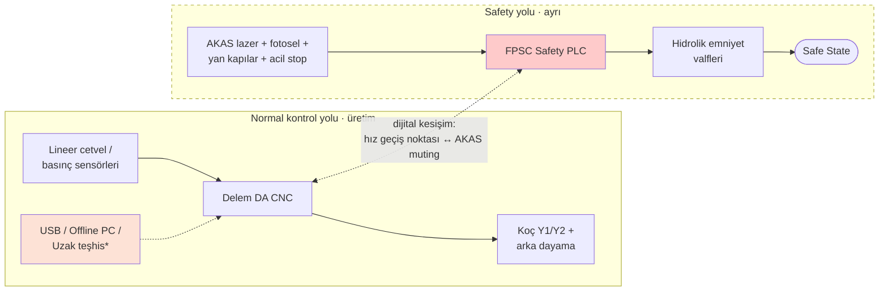

# 🛡️ Safety 4.0 Bootcamp — Abkant Pres Laboratuvarları (Hafta 1–7)

> **INSPECCO × KRIPTARIUM · Safety 4.0 Bootcamp**
> Ermaksan Power-Bend Pro CNC hidrolik abkant pres üzerinde **fonksiyonel emniyet (functional safety)** ile **endüstriyel siber güvenliği (OT security)** birleştiren laboratuvar çalışmaları.


---

## 📌 Bu repo nedir?

Bootcamp'in yedi haftasında doldurulan laboratuvar föylerinin düzenlenmiş, okunabilir ve sürüm kontrollü hâlidir. Her hafta tek bir soruya cevap verir ve bir sonraki haftanın girdisini üretir:

```
Hafta 1  Neyi koruyoruz?          → Safety Function Map
Hafta 2  Nasıl bölgelere ayırırız? → Zone / Conduit Diagram
Hafta 3  En büyük risk hangisi?    → Risk Register
Hafta 4  Uzaktan erişimi nasıl güvenli yaparız? → Secure Architecture
Hafta 5  Bir açık çıktığında ne yaparız? → Vulnerability Decision
Hafta 6  Saldırı olduysa ilk saatlerde ne yaparız? → Incident Workflow
Hafta 7  YZ yanılırsa insan nasıl korunur? → AI Fail-Safe Decision
```

## 🗂️ Haftalar

| Hafta | Laboratuvar | Çıktı | Evidence Pack |
|:---:|---|---|---|
| 01 | [Safety Architecture](labs/hafta-01-safety-architecture/) | Safety Function Map | EP 03 |
| 02 | [IEC 62443 Mini Workshop](labs/hafta-02-iec62443-zone-conduit/) | Zone / Conduit Diagram | EP 05 |
| 03 | [Threat & Risk + Risk Matrix](labs/hafta-03-threat-risk-matrix/) | Risk Register | EP 04 |
| 04 | [Secure Remote Access](labs/hafta-04-secure-remote-access/) | Secure Architecture | EP 02 + EP 06 |
| 05 | [SBOM / CVE / Patch](labs/hafta-05-sbom-cve-patch/) | Vulnerability Decision | EP 09 · 10 · 11 |
| 06 | [CRA Incident Simulation](labs/hafta-06-cra-incident-simulation/) | Incident Workflow | EP 13 |
| 07 | [AI Safety Challenge](labs/hafta-07-ai-safety-challenge/) | AI Fail-Safe Decision | EP 03 + EP 15 |

## 🏭 İncelenen makine

**Ermaksan Power-Bend Pro** CNC hidrolik abkant pres (örnek model: 3100 × 135 ton)

- **Tehlike:** inen koç (üst bıçak) ile alt kalıp arasında el/parmak ezilmesi
- **Emniyet zinciri:** Fiessler AKAS lazer + arka fotosel + kilitli yan kapılar → **FPSC emniyet kontrolörü** → hidrolik emniyet valfleri
- **Kontrol:** Delem DA serisi dokunmatik CNC (USB, offline programlama yazılımı), Y1/Y2 senkron hidrolik, CNC arka dayama
- **Bağlantı:** fabrika ağı / üretici uzak teşhis bağlantısı *(varsayım)*



## 📁 Repo yapısı

```
.
├── README.md                     ← buradasınız
├── SWOT.md                       ← bu çalışmanın SWOT analizi
├── labs/
│   ├── hafta-01-safety-architecture/
│   ├── hafta-02-iec62443-zone-conduit/
│   ├── hafta-03-threat-risk-matrix/
│   ├── hafta-04-secure-remote-access/
│   ├── hafta-05-sbom-cve-patch/
│   ├── hafta-06-cra-incident-simulation/
│   └── hafta-07-ai-safety-challenge/
├── docs/
│   └── kaynaklar-ve-varsayimlar.md
└── assets/
    ├── Lab_Foyleri_Hafta01-07.pdf  ← orijinal föylerin tamamı
    └── foyler/                     ← sayfa görüntüleri
```

## 🧭 Temel ilkeler

1. **Emniyet ≠ güvenlik, ama birbirine bağlı.** Siber bir müdahale, emniyet fonksiyonunu bozabiliyorsa emniyet sorunudur.
2. **Altın kural:** Zincir "veri çalındı" ile bitiyorsa emniyet bulgusu değildir — *bu, hattaki insana ne yapar?*
3. **S = 3 ise öne al:** Ciddiyet geri dönüşsüzse skor düşük olsa bile senaryo görünür kalır.
4. **İki katman, ikisi de şart:** erişim güvenliği (girişi zorlaştır) + emniyet bağımsızlığı (girse bile insan korunur).
5. **CVSS tek başına karar değildir:** bileşen var mı, sürüm etkileniyor mu, açık ulaşılabilir mi? Yama önce test edilir, sonra emniyet validasyonu tekrarlanır.
6. **Önce emniyet, hemen sonra kanıt:** olayda "resetleyip devam edelim" yok; CRA 24 s / 72 s / 14 gün akışın kilometre taşlarıdır.
7. **Prediction ≠ Safety:** YZ karar önerir; emniyeti garanti eden mimari YZ'nin dışındadır.

## 📚 Mevzuat ve standartlar

- **Makine Yönetmeliği (AB) 2023/1230** — 20 Ocak 2027'den itibaren
- **Siber Dayanıklılık Yasası (CRA) (AB) 2024/2847** — bildirim yükümlülükleri 11 Eylül 2026, tüm hükümler 11 Aralık 2027
- **EN 12622** (hidrolik abkant presler) · **EN ISO 13849-1** (PL) · **EN ISO 13855** (emniyet mesafesi) · **IEC 62443**

Ayrıntılı kaynak listesi ve varsayımlar: [docs/kaynaklar-ve-varsayimlar.md](docs/kaynaklar-ve-varsayimlar.md)

---

> ⚠️ **Sorumluluk reddi:** Bu içerik bir **eğitim çıktısıdır**; resmî denetim, uygunluk değerlendirmesi veya belgelendirme değildir ve CE/mevzuat uygunluğu garantisi vermez. Analiz yalnızca herkese açık bilgilere dayanır; üretici firmayla iletişime geçilmemiştir. Doğrulanamayan noktalar *(varsayım)* olarak işaretlenmiştir.
