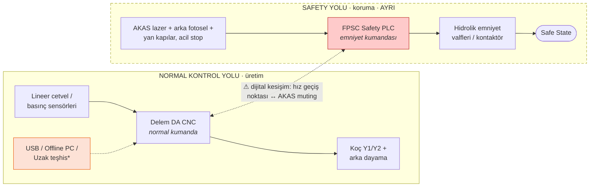
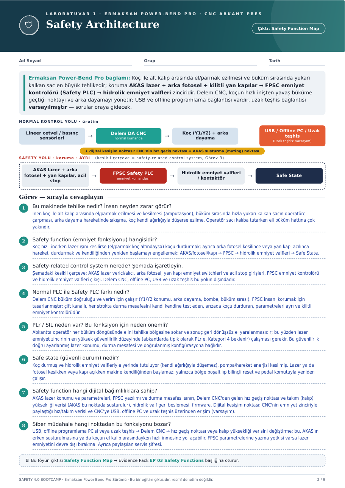

# 🛡 Hafta 01 · Safety Architecture

**Çıktı:** Safety Function Map → Evidence Pack **EP 03 Safety Functions**

[← Ana sayfa](../../README.md) · [Hafta 02 →](../hafta-02-iec62443-zone-conduit/)

---

## Bağlam

Koç ile alt kalıp arasında el/parmak ezilmesi ve büküm sırasında yukarı kalkan sac en büyük tehlikedir; koruma **AKAS lazer + arka fotosel + kilitli yan kapılar → FPSC emniyet kontrolörü (Safety PLC) → hidrolik emniyet valfleri** zinciridir. Delem CNC, koçun hızlı inişten yavaş büküme geçtiği noktayı ve arka dayamayı yönetir; USB ve offline programlama bağlantısı vardır, uzak teşhis bağlantısı **varsayılmıştır**.

## Safety Function Map

* uzak teşhis: varsayım · kesikli çerçeve = safety-related control system

## Görev — cevaplar

### 1. Bu makinede tehlike nedir? İnsan neyden zarar görür?
İnen koç ile alt kalıp arasında el/parmak ezilmesi ve kesilmesi (amputasyon), büküm sırasında hızla yukarı kalkan sacın operatöre çarpması, arka dayama hareketinde sıkışma, koç kendi ağırlığıyla düşerse ezilme. Operatör sacı kalıba tutarken eli büküm hattına çok yakındır.

### 2. Safety function (emniyet fonksiyonu) hangisidir?
Koç hızlı inerken lazer ışını kesilirse (el/parmak koç altındaysa) koçu durdurmak; ayrıca arka fotosel kesilince veya yan kapı açılınca hareketi durdurmak ve kendiliğinden yeniden başlamayı engellemek:
**AKAS/fotosel/kapı → FPSC → hidrolik emniyet valfleri → Safe State.**

### 3. Safety-related control system nerede?
Şemadaki kesikli çerçeve: AKAS lazer verici/alıcı, arka fotosel, yan kapı emniyet switchleri ve acil stop girişleri, FPSC emniyet kontrolörü ve hidrolik emniyet valfleri çıkışı. Delem CNC, offline PC, USB ve uzak teşhis bu yolun **dışındadır**.

### 4. Normal PLC ile Safety PLC farkı nedir?
| Delem CNC (normal kumanda) | FPSC (emniyet kumandası) |
|---|---|
| Büküm doğruluğu ve verim için çalışır | İnsanı korumak için tasarlanmıştır |
| Y1/Y2 konumu, arka dayama, bombe, büküm sırası | Çift kanallı, her strokta durma mesafesini kendi kendine test eder |
| Parametreler üretim ihtiyacına göre değişir | Arızada koçu durdurur; parametreleri ayrı ve kilitli |

### 5. PLr / SIL neden var? Bu fonksiyon için neden önemli?
Abkantta operatör her büküm döngüsünde elini tehlike bölgesine sokar ve sonuç geri dönüşsüz el yaralanmasıdır; bu yüzden lazer emniyet zincirinin en yüksek güvenilirlik düzeyinde (abkantlarda tipik olarak **PLr e, Kategori 4** beklenir) çalışması gerekir. Bu güvenilirlik doğru ayarlanmış lazer konumu, durma mesafesi ve doğrulanmış konfigürasyona bağlıdır.

### 6. Safe state (güvenli durum) nedir?
Koç durmuş ve hidrolik emniyet valfleriyle yerinde tutuluyor (kendi ağırlığıyla düşemez), pompa/hareket enerjisi kesilmiş. Lazer ya da fotosel kesikken veya kapı açıkken makine kendiliğinden başlamaz; yalnızca bölge boşaltılıp bilinçli reset ve pedal komutuyla yeniden çalışır.

### 7. Safety function hangi dijital bağımlılıklara sahip?
AKAS lazer konumu ve parametreleri, FPSC yazılımı ve durma mesafesi sınırı, Delem CNC'den gelen hız geçiş noktası ve takım (kalıp) yüksekliği verisi (AKAS bu noktada susturulur), hidrolik valf geri beslemesi, firmware.
**Dijital kesişim noktası:** CNC'nin emniyet zinciriyle paylaştığı hız/takım verisi ve CNC'ye USB, offline PC ve uzak teşhis üzerinden erişim *(varsayım)*.

### 8. Siber müdahale hangi noktadan bu fonksiyonu bozar?
USB, offline programlama PC'si veya uzak teşhis → Delem CNC → hız geçiş noktası veya kalıp yüksekliği verisini değiştirme; bu, AKAS'ın erken susturulmasına ya da koçun el kalıp arasındayken hızlı inmesine yol açabilir. FPSC parametrelerine yazma yetkisi varsa lazer emniyetini devre dışı bırakma. Ayrıca paylaşılan servis şifresi.

---

📄 Orijinal föy sayfası

