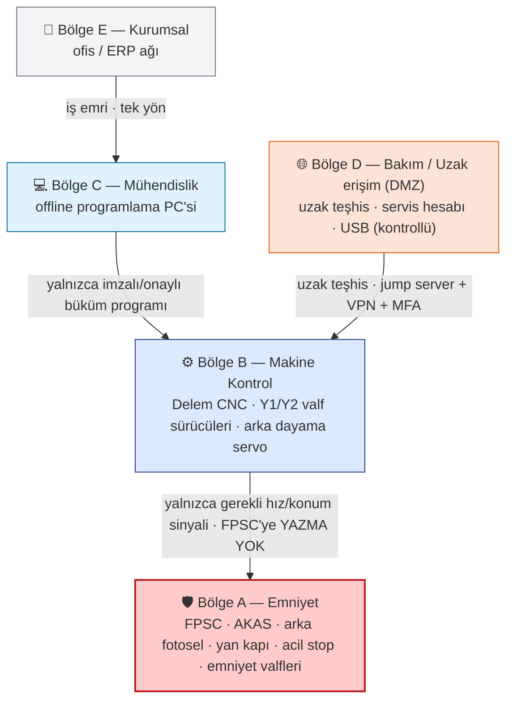
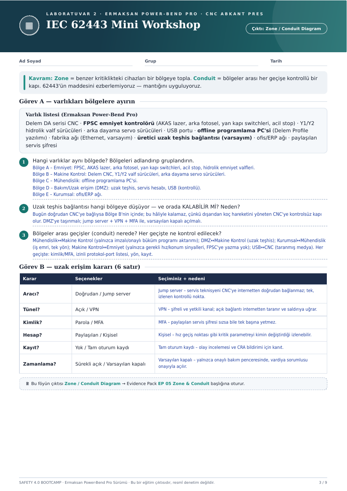

# ▦ Hafta 02 · IEC 62443 Mini Workshop

**Çıktı:** Zone / Conduit Diagram → Evidence Pack **EP 05 Zone & Conduit**

[← Hafta 01](../hafta-01-safety-architecture/) · [Ana sayfa](../../README.md) · [Hafta 03 →](../hafta-03-threat-risk-matrix/)

---

> **Kavram:** **Zone** = benzer kritiklikteki cihazları bir bölgeye topla. **Conduit** = bölgeler arası her geçişe kontrollü bir kapı. 62443'ün maddesini ezberlemiyoruz — mantığını uyguluyoruz.

## Varlık listesi

Delem DA serisi CNC · **FPSC emniyet kontrolörü** (AKAS lazer, arka fotosel, yan kapı switchleri, acil stop) · Y1/Y2 hidrolik valf sürücüleri · arka dayama servo sürücüleri · USB portu · **offline programlama PC'si** (Delem Profile yazılımı) · fabrika ağı (Ethernet, *varsayım*) · **üretici uzak teşhis bağlantısı** (*varsayım*) · ofis/ERP ağı · paylaşılan servis şifresi

## Zone / Conduit Diagram

## Görev A — varlıkları bölgelere ayırın

### 1. Hangi varlıklar aynı bölgede?
| Bölge | Varlıklar |
|---|---|
| **A – Emniyet** | FPSC, AKAS lazer, arka fotosel, yan kapı switchleri, acil stop, hidrolik emniyet valfleri |
| **B – Makine Kontrol** | Delem CNC, Y1/Y2 valf sürücüleri, arka dayama servo sürücüleri |
| **C – Mühendislik** | Offline programlama PC'si |
| **D – Bakım/Uzak erişim (DMZ)** | Uzak teşhis, servis hesabı, USB (kontrollü) |
| **E – Kurumsal** | Ofis/ERP ağı |

### 2. Uzak teşhis bağlantısı hangi bölgeye düşüyor — orada KALABİLİR Mİ?
Bugün doğrudan CNC'ye bağlıysa Bölge B'nin içinde; bu hâliyle **kalamaz**, çünkü dışarıdan koç hareketini yöneten CNC'ye kontrolsüz kapı olur. DMZ'ye taşınmalı; jump server + VPN + MFA ile, varsayılan kapalı açılmalı.

### 3. Bölgeler arası geçişler (conduit) nerede? Her geçişte ne kontrol edilecek?
| Conduit | Kural |
|---|---|
| Mühendislik ↔ Makine Kontrol | Yalnızca imzalı/onaylı büküm programı aktarımı |
| DMZ ↔ Makine Kontrol | Uzak teşhis |
| Kurumsal ↔ Mühendislik | İş emri, tek yön |
| Makine Kontrol ↔ Emniyet | Yalnızca gerekli hız/konum sinyalleri, FPSC'ye yazma yok |
| USB ↔ CNC | Taranmış medya |

**Her geçişte:** kimlik/MFA · izinli protokol-port listesi · yön · kayıt.

## Görev B — uzak erişim kararı

| Karar | Seçenekler | Seçim | Neden |
|---|---|---|---|
| Aracı? | Doğrudan / Jump server | **Jump server** | Servis teknisyeni CNC'ye internetten doğrudan bağlanmaz; tek, izlenen kontrollü nokta |
| Tünel? | Açık / VPN | **VPN** | Şifreli ve yetkili kanal; açık bağlantı internetten taranır ve saldırıya uğrar |
| Kimlik? | Parola / MFA | **MFA** | Paylaşılan servis şifresi sızsa bile tek başına yetmez |
| Hesap? | Paylaşılan / Kişisel | **Kişisel** | Hız geçiş noktası gibi kritik parametreyi kimin değiştirdiği izlenebilir |
| Kayıt? | Yok / Tam oturum kaydı | **Tam oturum kaydı** | Olay incelemesi ve CRA bildirimi için kanıt |
| Zamanlama? | Sürekli açık / Varsayılan kapalı | **Varsayılan kapalı** | Yalnızca onaylı bakım penceresinde, vardiya sorumlusu onayıyla açılır |

---

📄 Orijinal föy sayfası

