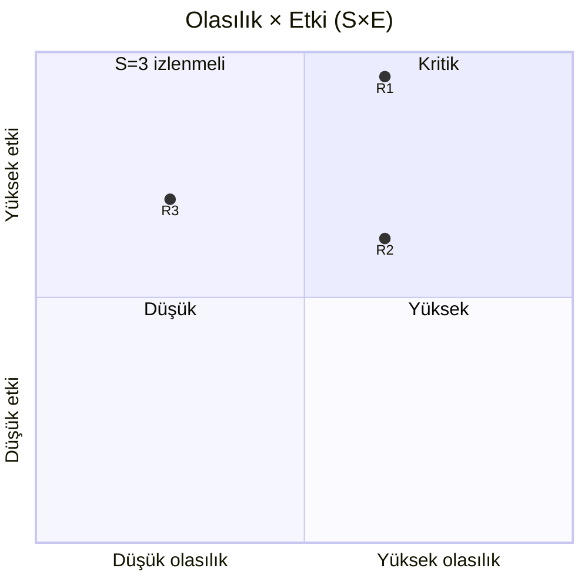
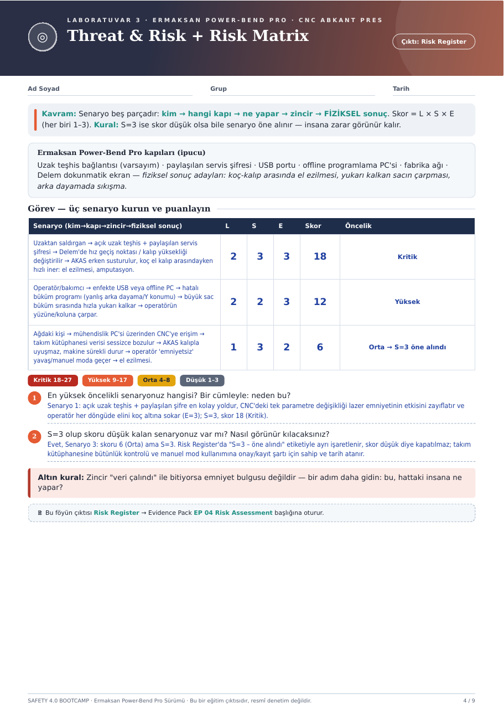

# ◎ Hafta 03 · Threat & Risk + Risk Matrix

**Çıktı:** Risk Register → Evidence Pack **EP 04 Risk Assessment**

[← Hafta 02](../hafta-02-iec62443-zone-conduit/) · [Ana sayfa](../../README.md) · [Hafta 04 →](../hafta-04-secure-remote-access/)

---

> **Kavram:** Senaryo beş parçadır: **kim → hangi kapı → ne yapar → zincir → FİZİKSEL sonuç**.
> Skor = **L × S × E** (her biri 1–3) · L: olasılık · S: ciddiyet · E: maruziyet
> **Kural:** S = 3 ise skor düşük olsa bile senaryo öne alınır — insana zarar görünür kalır.

**Kapılar (ipucu):** uzak teşhis bağlantısı *(varsayım)* · paylaşılan servis şifresi · USB portu · offline programlama PC'si · fabrika ağı · Delem dokunmatik ekran
**Fiziksel sonuç adayları:** koç-kalıp arasında el ezilmesi · yukarı kalkan sacın çarpması · arka dayamada sıkışma

## Risk Register

| # | Senaryo (kim → kapı → zincir → fiziksel sonuç) | L | S | E | Skor | Öncelik |
|:-:|---|:-:|:-:|:-:|:-:|---|
| R1 | **Uzaktan saldırgan** → açık uzak teşhis + paylaşılan servis şifresi → Delem'de hız geçiş noktası / kalıp yüksekliği değiştirilir → AKAS erken susturulur, koç el kalıp arasındayken hızlı iner → **el ezilmesi, amputasyon** | 2 | 3 | 3 | **18** | 🔴 Kritik |
| R2 | **Operatör/bakımcı** → enfekte USB veya offline PC → hatalı büküm programı (yanlış arka dayama/Y konumu) → büyük sac büküm sırasında hızla yukarı kalkar → **operatörün yüzüne/koluna çarpar** | 2 | 2 | 3 | **12** | 🟠 Yüksek |
| R3 | **Ağdaki kişi** → mühendislik PC'si üzerinden CNC'ye erişim → takım kütüphanesi verisi sessizce bozulur → AKAS kalıpla uyuşmaz, makine sürekli durur → operatör "emniyetsiz" yavaş/manuel moda geçer → **el ezilmesi** | 1 | 3 | 2 | **6** | 🟡 Orta → ⚑ **S=3 öne alındı** |

**Skor bantları:** 🔴 Kritik 18–27 · 🟠 Yüksek 9–17 · 🟡 Orta 4–8 · ⚪ Düşük 1–3

## Sorular

### 1. En yüksek öncelikli senaryo hangisi? Neden?
**R1:** açık uzak teşhis + paylaşılan şifre en kolay yoldur, CNC'deki tek parametre değişikliği lazer emniyetinin etkisini zayıflatır ve operatör her döngüde elini koç altına sokar (E=3); S=3, skor 18 (Kritik).

### 2. S=3 olup skoru düşük kalan senaryo var mı? Nasıl görünür kılınır?
Evet, **R3**: skoru 6 (Orta) ama S=3. Risk Register'da **"S=3 – öne alındı"** etiketiyle ayrı işaretlenir, skor düşük diye kapatılmaz; takım kütüphanesine bütünlük kontrolü ve manuel mod kullanımına onay/kayıt şartı için sahip ve tarih atanır.

> **🥇 Altın kural:** Zincir "veri çalındı" ile bitiyorsa emniyet bulgusu değildir — bir adım daha gidin: *bu, hattaki insana ne yapar?*

---

📄 Orijinal föy sayfası

