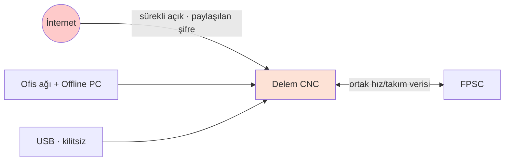
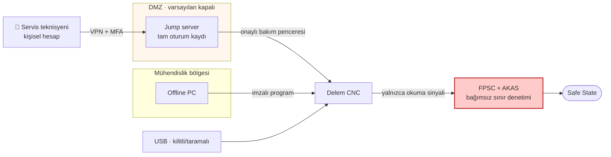
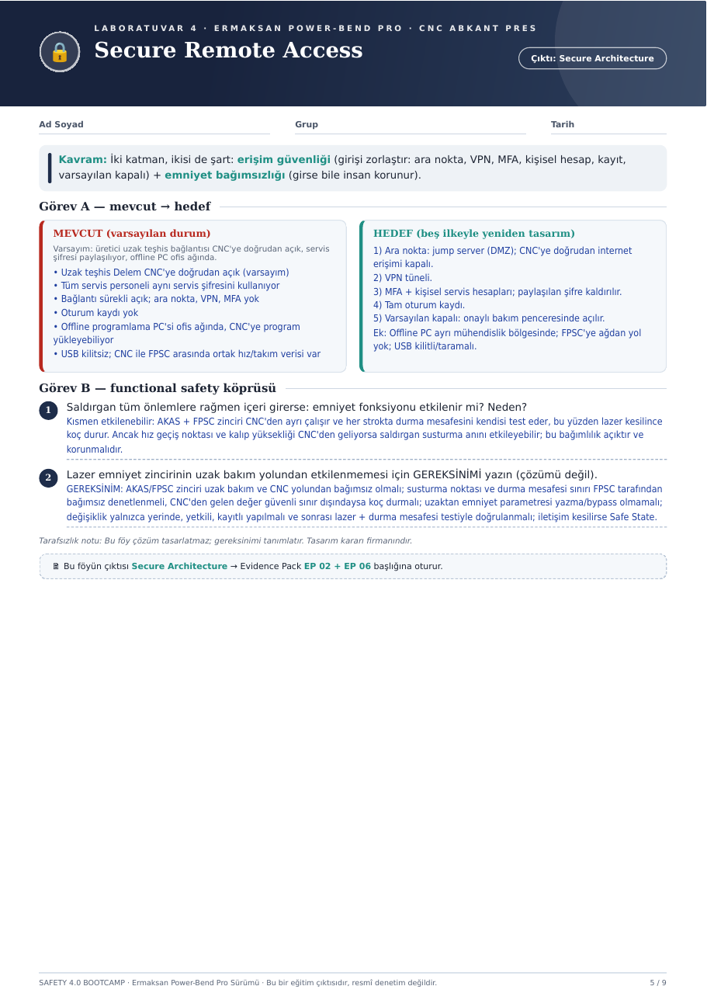

# 🔒 Hafta 04 · Secure Remote Access

**Çıktı:** Secure Architecture → Evidence Pack **EP 02 + EP 06**

[← Hafta 03](../hafta-03-threat-risk-matrix/) · [Ana sayfa](../../README.md)

---

> **Kavram:** İki katman, ikisi de şart:
> **erişim güvenliği** (girişi zorlaştır: ara nokta, VPN, MFA, kişisel hesap, kayıt, varsayılan kapalı) +
> **emniyet bağımsızlığı** (girse bile insan korunur).

## Görev A — mevcut → hedef

| ❌ MEVCUT (varsayılan durum) | ✅ HEDEF (beş ilkeyle yeniden tasarım) |
|---|---|
| Uzak teşhis Delem CNC'ye doğrudan açık *(varsayım)* | **1) Ara nokta:** jump server (DMZ); CNC'ye doğrudan internet erişimi kapalı |
| Bağlantı sürekli açık; ara nokta, VPN, MFA yok | **2) VPN tüneli** |
| Tüm servis personeli aynı servis şifresini kullanıyor | **3) MFA + kişisel servis hesapları;** paylaşılan şifre kaldırılır |
| Oturum kaydı yok | **4) Tam oturum kaydı** |
| Bağlantı sürekli açık | **5) Varsayılan kapalı:** onaylı bakım penceresinde açılır |
| Offline programlama PC'si ofis ağında, CNC'ye program yükleyebiliyor | **Ek:** Offline PC ayrı mühendislik bölgesinde |
| USB kilitsiz; CNC ile FPSC arasında ortak hız/takım verisi var | **Ek:** FPSC'ye ağdan yol yok; USB kilitli/taramalı |

### Mevcut mimari

### Hedef mimari

## Görev B — functional safety köprüsü

### 1. Saldırgan tüm önlemlere rağmen içeri girerse emniyet fonksiyonu etkilenir mi?
**Kısmen etkilenebilir.** AKAS + FPSC zinciri CNC'den ayrı çalışır ve her strokta durma mesafesini kendisi test eder, bu yüzden lazer kesilince koç durur. Ancak hız geçiş noktası ve kalıp yüksekliği CNC'den geliyorsa saldırgan susturma anını etkileyebilir; bu bağımlılık açıktır ve korunmalıdır.

### 2. Lazer emniyet zincirinin uzak bakım yolundan etkilenmemesi için GEREKSİNİM
- [ ] AKAS/FPSC zinciri uzak bakım ve CNC yolundan **bağımsız** olmalı
- [ ] Susturma noktası ve durma mesafesi sınırı FPSC tarafından **bağımsız denetlenmeli**; CNC'den gelen değer güvenli sınır dışındaysa koç durmalı
- [ ] Uzaktan emniyet parametresi **yazma/bypass olmamalı**
- [ ] Değişiklik yalnızca **yerinde, yetkili, kayıtlı** yapılmalı ve sonrası lazer + durma mesafesi testiyle doğrulanmalı
- [ ] İletişim kesilirse **Safe State**

> *Tarafsızlık notu: Bu föy çözüm tasarlatmaz; gereksinimi tanımlatır. Tasarım kararı firmanındır.*

---

📄 Orijinal föy sayfası

