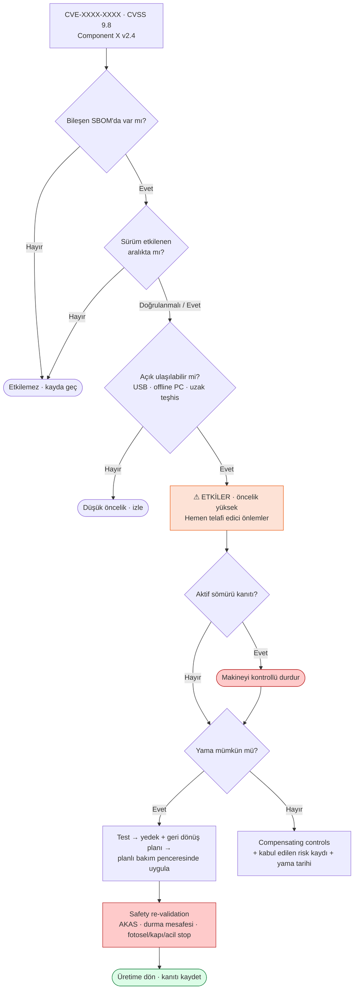
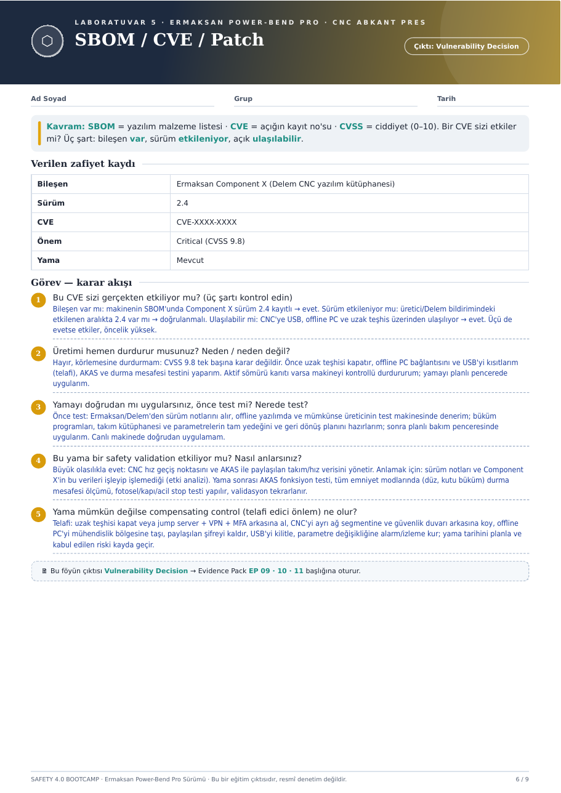

# ⬡ Hafta 05 · SBOM / CVE / Patch

**Çıktı:** Vulnerability Decision → Evidence Pack **EP 09 · 10 · 11**

[← Hafta 04](../hafta-04-secure-remote-access/) · [Ana sayfa](../../README.md) · [Hafta 06 →](../hafta-06-cra-incident-simulation/)

---

> **Kavram:** **SBOM** = yazılım malzeme listesi · **CVE** = açığın kayıt numarası · **CVSS** = ciddiyet (0–10).
> Bir CVE sizi etkiler mi? **Üç şart:** bileşen var · sürüm etkileniyor · açık ulaşılabilir.

## Verilen zafiyet kaydı

| Alan | Değer |
|---|---|
| Bileşen | Ermaksan Component X (Delem CNC yazılım kütüphanesi) |
| Sürüm | 2.4 |
| CVE | CVE-XXXX-XXXX |
| Önem | 🔴 **Critical (CVSS 9.8)** |
| Yama | Mevcut |

Kayıt, föyde verilen eğitim amaçlı örnek bir zafiyettir; gerçek bir CVE değildir.

## Karar akışı

## Görev — cevaplar

### 1. Bu CVE sizi gerçekten etkiliyor mu? (üç şart)
| Şart | Kontrol | Sonuç |
|---|---|---|
| Bileşen var mı? | Makinenin SBOM'unda Component X sürüm 2.4 kayıtlı | ✅ Evet |
| Sürüm etkileniyor mu? | Üretici/Delem bildirimindeki etkilenen aralıkta 2.4 var mı? | ❓ Doğrulanmalı |
| Ulaşılabilir mi? | CNC'ye USB, offline PC ve uzak teşhis üzerinden ulaşılıyor | ✅ Evet |

Üçü de evetse **etkiler, öncelik yüksek.**

### 2. Üretimi hemen durdurur musunuz? Neden / neden değil?
**Hayır, körlemesine durdurmam:** CVSS 9.8 tek başına karar değildir. Önce uzak teşhisi kapatır, offline PC bağlantısını ve USB'yi kısıtlarım (telafi), AKAS ve durma mesafesi testini yaparım. **Aktif sömürü kanıtı varsa** makineyi kontrollü durdururum; yamayı planlı pencerede uygularım.

### 3. Yamayı doğrudan mı uygularsınız, önce test mi? Nerede test?
**Önce test.**
1. Ermaksan/Delem'den sürüm notlarını al.
2. Offline yazılımda ve mümkünse üreticinin test makinesinde dene.
3. Büküm programları, takım kütüphanesi ve parametrelerin **tam yedeğini** ve **geri dönüş planını** hazırla.
4. Planlı bakım penceresinde uygula.

Canlı makinede doğrudan uygulamam.

### 4. Bu yama bir safety validation'ı etkiliyor mu? Nasıl anlarsınız?
**Büyük olasılıkla evet:** CNC, hız geçiş noktasını ve AKAS ile paylaşılan takım/hız verisini yönetir.

- **Anlamak için:** sürüm notları + Component X'in bu verileri işleyip işlemediği (etki analizi).
- **Yama sonrası:**
  - [ ] AKAS fonksiyon testi
  - [ ] Tüm emniyet modlarında (düz, kutu büküm) durma mesafesi ölçümü
  - [ ] Fotosel / kapı / acil stop testi
  - [ ] Validasyonun tekrarlanması ve kayda geçirilmesi

### 5. Yama mümkün değilse compensating control ne olur?
| Önlem | Bağlantı |
|---|---|
| Uzak teşhisi kapat veya jump server + VPN + MFA arkasına al | [Hafta 04](../hafta-04-secure-remote-access/) |
| CNC'yi ayrı ağ segmentine ve güvenlik duvarı arkasına koy | [Hafta 02](../hafta-02-iec62443-zone-conduit/) |
| Offline PC'yi mühendislik bölgesine taşı | Hafta 02 – Bölge C |
| Paylaşılan şifreyi kaldır | Hafta 03 – R1 |
| USB'yi kilitle | Hafta 03 – R2 |
| Parametre değişikliğine alarm/izleme kur | Hafta 03 – R3 |
| Yama tarihini planla, kabul edilen riski kayda geçir | EP 11 |

---

📄 Orijinal föy sayfası

