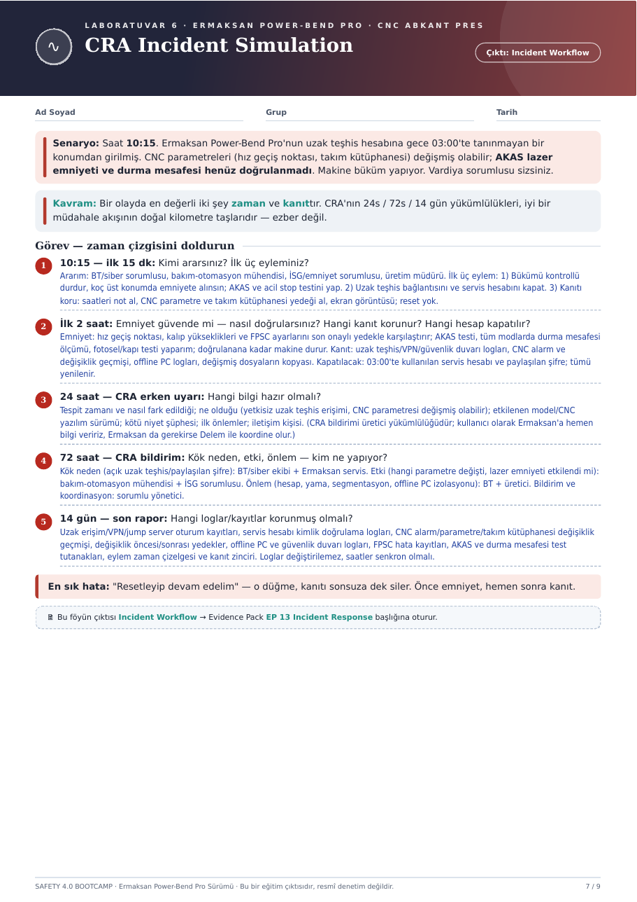

# ∿ Hafta 06 · CRA Incident Simulation

**Çıktı:** Incident Workflow → Evidence Pack **EP 13 Incident Response**

[← Hafta 05](../hafta-05-sbom-cve-patch/) · [Ana sayfa](../../README.md) · [Hafta 07 →](../hafta-07-ai-safety-challenge/)

---

> **🚨 Senaryo:** Saat **10:15**. Ermaksan Power-Bend Pro'nun uzak teşhis hesabına gece **03:00**'te tanınmayan bir konumdan girilmiş. CNC parametreleri (hız geçiş noktası, takım kütüphanesi) değişmiş olabilir; AKAS lazer emniyeti ve durma mesafesi henüz doğrulanmadı. Makine büküm yapıyor. **Vardiya sorumlusu sizsiniz.**

> **Kavram:** Bir olayda en değerli iki şey **zaman** ve **kanıttır**. CRA'nın **24 s / 72 s / 14 gün** yükümlülükleri, iyi bir müdahale akışının doğal kilometre taşlarıdır — ezber değil.

## Zaman çizgisi

```mermaid
timeline
    title Olay müdahale akışı
    03:00 : Tanınmayan konumdan uzak teşhis girişi
    10:15 (ilk 15 dk) : Bükümü kontrollü durdur : Uzak erişimi ve servis hesabını kapat : Kanıtı koru, reset yok
    İlk 2 saat : Parametreleri onaylı yedekle karşılaştır : AKAS + durma mesafesi + fotosel/kapı testi : Logları topla
    24 saat : CRA erken uyarı bilgileri hazır : Ermaksan'a bildirim
    72 saat : Kök neden, etki, önlem : Görev dağılımı
    14 gün : Son rapor : Değiştirilemez loglar ve kanıt zinciri
```

## Görev — cevaplar

### 1. ⏱ 10:15 — ilk 15 dakika: Kimi ararsınız? İlk üç eyleminiz?

**Ararım:** BT/siber sorumlusu · bakım-otomasyon mühendisi · İSG/emniyet sorumlusu · üretim müdürü

| # | Eylem |
|:-:|---|
| 1 | **Önce emniyet:** bükümü kontrollü durdur, koç üst konumda emniyete alınsın; AKAS ve acil stop testini yap |
| 2 | **Kapıyı kapat:** uzak teşhis bağlantısını ve servis hesabını kapat |
| 3 | **Kanıtı koru:** saatleri not al, CNC parametre ve takım kütüphanesi yedeği al, ekran görüntüsü; **reset yok** |

### 2. 🕑 İlk 2 saat: Emniyet güvende mi? Hangi kanıt korunur? Hangi hesap kapatılır?

| Başlık | Yapılacaklar |
|---|---|
| **Emniyet doğrulama** | Hız geçiş noktası, kalıp yükseklikleri ve FPSC ayarları son onaylı yedekle karşılaştırılır; AKAS testi, tüm modlarda durma mesafesi ölçümü, fotosel/kapı testi. **Doğrulanana kadar makine durur.** |
| **Korunan kanıt** | Uzak teşhis / VPN / güvenlik duvarı logları, CNC alarm ve değişiklik geçmişi, offline PC logları, değişmiş dosyaların kopyası |
| **Kapatılan hesap** | 03:00'te kullanılan servis hesabı ve paylaşılan şifre; **tümü yenilenir** |

### 3. 📣 24 saat — CRA erken uyarı: Hangi bilgi hazır olmalı?

- [ ] Tespit zamanı ve nasıl fark edildiği
- [ ] Ne olduğu (yetkisiz uzak teşhis erişimi, CNC parametresi değişmiş olabilir)
- [ ] Etkilenen model / CNC yazılım sürümü
- [ ] Kötü niyet şüphesi
- [ ] İlk önlemler
- [ ] İletişim kişisi

> ℹ️ CRA bildirimi **üretici** yükümlülüğüdür. Kullanıcı olarak Ermaksan'a hemen bilgi veririz; Ermaksan da gerekirse Delem ile koordine olur.

### 4. 📋 72 saat — CRA bildirim: Kök neden, etki, önlem — kim ne yapıyor?

| Konu | Sorumlu |
|---|---|
| **Kök neden** (açık uzak teşhis / paylaşılan şifre) | BT/siber ekibi + Ermaksan servis |
| **Etki** (hangi parametre değişti, lazer emniyeti etkilendi mi) | Bakım-otomasyon mühendisi + İSG sorumlusu |
| **Önlem** (hesap, yama, segmentasyon, offline PC izolasyonu) | BT + üretici |
| **Bildirim ve koordinasyon** | Sorumlu yönetici |

### 5. 🗂 14 gün — son rapor: Hangi loglar/kayıtlar korunmuş olmalı?

- Uzak erişim / VPN / jump server oturum kayıtları
- Servis hesabı kimlik doğrulama logları
- CNC alarm / parametre / takım kütüphanesi değişiklik geçmişi
- Değişiklik öncesi/sonrası yedekler
- Offline PC ve güvenlik duvarı logları
- FPSC hata kayıtları
- AKAS ve durma mesafesi test tutanakları
- Eylem zaman çizelgesi ve kanıt zinciri

**Loglar değiştirilemez, saatler senkron olmalı.**

> ⚠️ **En sık hata:** *"Resetleyip devam edelim"*. O düğme kanıtı sonsuza dek siler. **Önce emniyet, hemen sonra kanıt.**

---

<details>
<summary>📄 Orijinal föy sayfası</summary>


</details>
