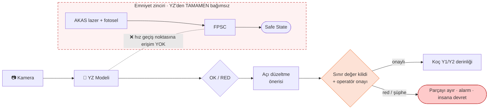
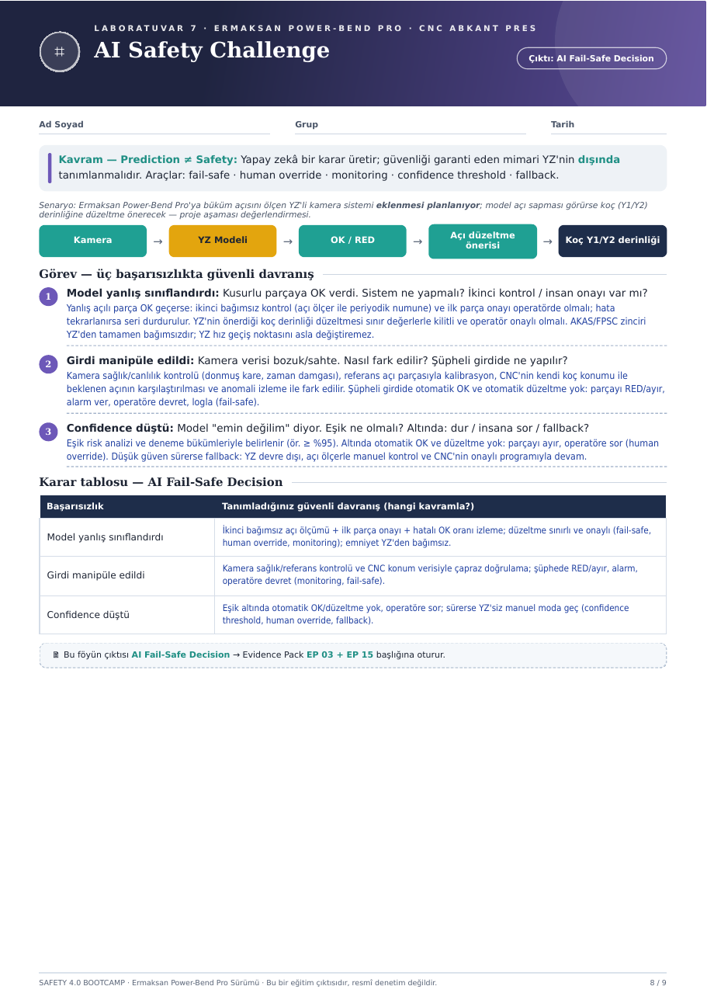

# ⌗ Hafta 07 · AI Safety Challenge

**Çıktı:** AI Fail-Safe Decision → Evidence Pack **EP 03 + EP 15**

[← Hafta 06](../hafta-06-cra-incident-simulation/) · [Ana sayfa](../../README.md)

---

> **Kavram — Prediction ≠ Safety:** Yapay zekâ bir karar üretir; güvenliği garanti eden mimari **YZ'nin dışında** tanımlanmalıdır.
> **Araçlar:** fail-safe · human override · monitoring · confidence threshold · fallback

**Senaryo:** Ermaksan Power-Bend Pro'ya büküm açısını ölçen YZ'li kamera sistemi eklenmesi planlanıyor. Model açı sapması görürse koç (Y1/Y2) derinliğine düzeltme önerecek. *Proje aşaması değerlendirmesi.*

## Mimari

## Görev — üç başarısızlıkta güvenli davranış

### 1. Model yanlış sınıflandırdı: kusurlu parçaya OK verdi
- **İkinci bağımsız kontrol:** açı ölçer ile periyodik numune
- **İlk parça onayı** operatörde olmalı; hata tekrarlanırsa seri durdurulur
- YZ'nin önerdiği koç derinliği düzeltmesi **sınır değerlerle kilitli ve operatör onaylı** olmalı
- AKAS/FPSC zinciri YZ'den tamamen bağımsızdır; **YZ hız geçiş noktasını asla değiştiremez**

### 2. Girdi manipüle edildi: kamera verisi bozuk/sahte
**Nasıl fark edilir?**
- Kamera sağlık/canlılık kontrolü (donmuş kare, zaman damgası)
- Referans açı parçasıyla kalibrasyon
- CNC'nin kendi koç konumu ile beklenen açının karşılaştırılması
- Anomali izleme

**Şüpheli girdide:** otomatik OK ve otomatik düzeltme **yok**. Parçayı RED/ayır, alarm ver, operatöre devret, logla *(fail-safe)*.

### 3. Confidence düştü: model "emin değilim" diyor
- **Eşik:** risk analizi ve deneme bükümleriyle belirlenir (ör. **≥ %95**)
- **Eşik altında:** otomatik OK ve düzeltme yok; parçayı ayır, operatöre sor *(human override)*
- **Düşük güven sürerse fallback:** YZ devre dışı; açı ölçerle manuel kontrol ve CNC'nin onaylı programıyla devam

## Karar tablosu — AI Fail-Safe Decision

| Başarısızlık | Güvenli davranış | Kavram |
|---|---|---|
| **Model yanlış sınıflandırdı** | İkinci bağımsız açı ölçümü + ilk parça onayı + hatalı OK oranı izleme; düzeltme sınırlı ve onaylı; emniyet YZ'den bağımsız | `fail-safe` `human override` `monitoring` |
| **Girdi manipüle edildi** | Kamera sağlık/referans kontrolü ve CNC konum verisiyle çapraz doğrulama; şüphede RED/ayır, alarm, operatöre devret | `monitoring` `fail-safe` |
| **Confidence düştü** | Eşik altında otomatik OK/düzeltme yok, operatöre sor; sürerse YZ'siz manuel moda geç | `confidence threshold` `human override` `fallback` |

---

📄 Orijinal föy sayfası

